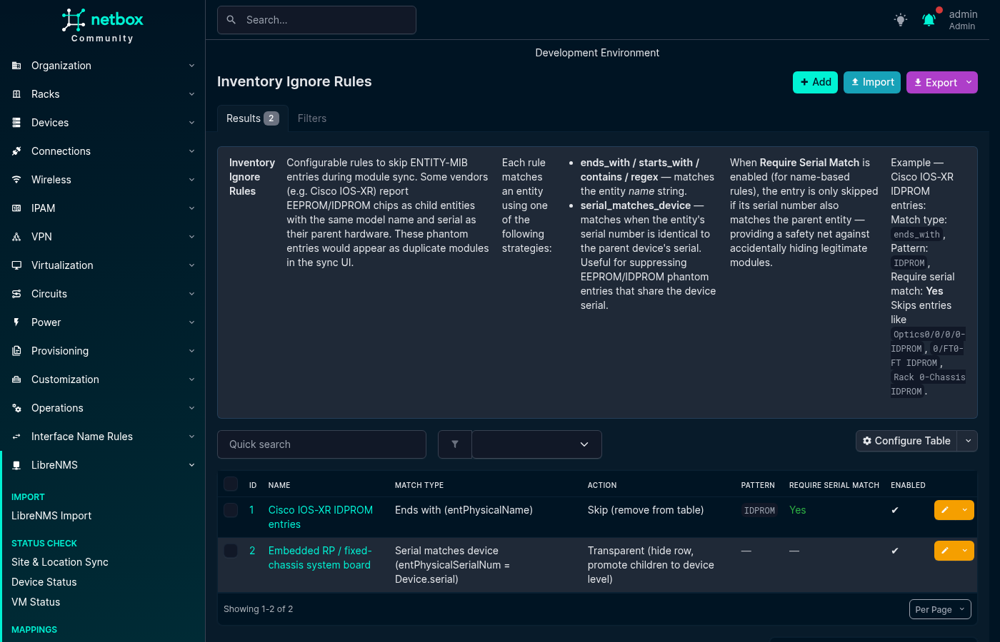
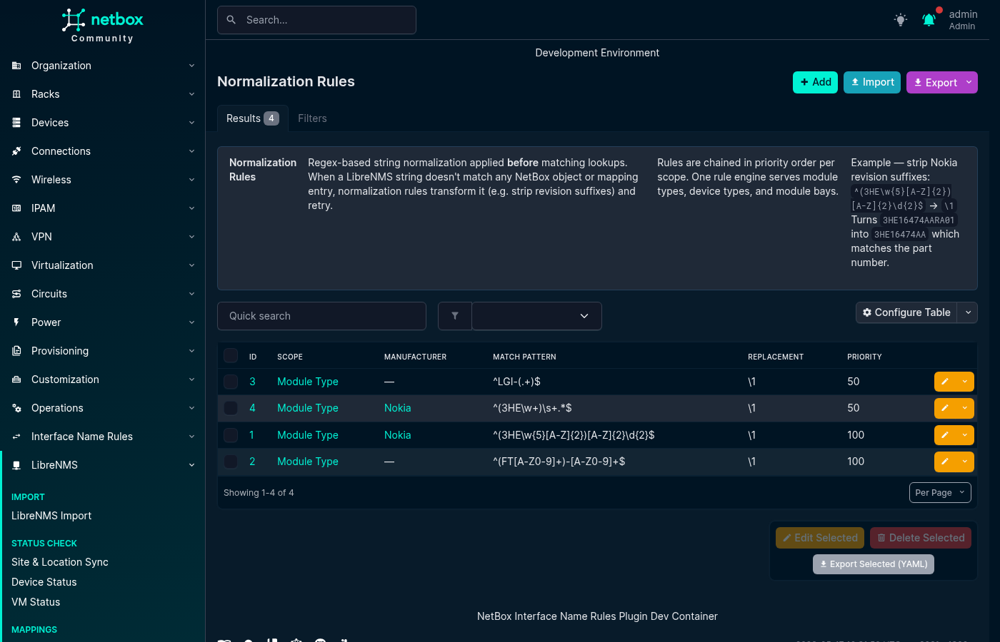
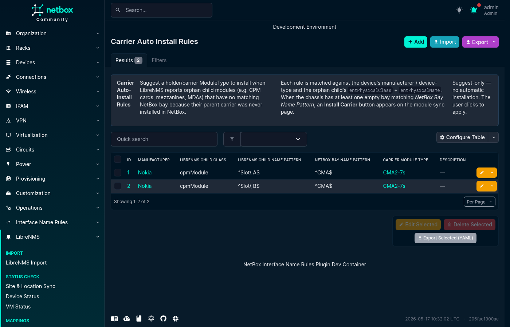

# Rules & Patterns

Rules and patterns transform or filter LibreNMS data when a direct mapping is not enough. Open **LibreNMS → Rules & Patterns** and use the tabs at the top of the page to switch between rule types.

Each tab supports creating, editing, deleting, filtering, bulk importing, and exporting rules or patterns.

## Inventory Ignore Rules

Inventory Ignore Rules control which ENTITY-MIB inventory items appear in Module Sync and how their children are handled.

The available actions are:

- **Skip** removes the matched item from the sync table. Use this for phantom EEPROM or IDPROM entities that duplicate a parent component.
- **Transparent** hides the matched row and promotes its children to device-level bay matching. Use this for a fixed-chassis system board whose children should match device-level bays.
- **Include** admits the inventory rows of one `entPhysicalClass` to Module Sync. This action must be paired with the **Class is** match type. See [Inventory classes](#inventory-classes).

Name-based rules can use **Ends with**, **Starts with**, **Contains**, or a Python regular expression against `entPhysicalName`. These comparisons are case-insensitive except for regular expressions, whose behavior is controlled by the expression. **Serial matches device** compares `entPhysicalSerialNum` with the NetBox device serial. **Model matches device type** compares `entPhysicalModelName` case-insensitively with the model and the part number of the NetBox device type. **Class is** compares `entPhysicalClass` case-insensitively. The Include action needs it, and a Skip or Transparent rule can use it too. An Include rule ignores **Require serial match parent**.

For name-based rules and for Skip or Transparent **Class is** rules, **Require serial match parent** adds a safety check: the rule applies only when the item's serial also matches an ancestor entity's serial. A row without a serial never passes this check, so clear the flag on a rule that must match such rows.

Every rule can also carry the optional filters that [Filters](#filters) describes. A rule then applies only when its match type and every non-blank filter match.

**Serial matches device** and **Model matches device type** need no pattern, and they ignore **Require serial match parent**. Both match only a chassis-level item: an item with no parent, or an item whose direct parent is the `chassis` entity. **Model matches device type** also matches an item that reaches the chassis through `container` entities only, such as a slot container. It never matches the chassis entity itself. In a virtual chassis, each item is compared with the member that it targets.

Fixed Cisco IOS XE platforms, such as the C8500L-8S4X, report their built-in units as `module` entities directly below the chassis: `module 0` (SPA Interface Processor), `module R0` (route processor) and `module F0` (ESP). These entities report the chassis PID as their model. `module R0` has its own serial, so **Serial matches device** does not match it. A name rule is not safe either, because on a modular platform such as the ASR 1000 the same names are field-replaceable units with their own PIDs. A **Model matches device type** rule with the **Transparent** action hides the three rows and matches their subslots and transceivers against device-level bays.

Fixed Cisco NX-OS platforms, such as the Nexus 93180YC-FX, report their built-in line card as a `module` with the chassis PID inside a `LinecardSlot-1` container. The same rule hides that row. **Serial matches device** does not match it, because that rule only accepts a direct child of the chassis: on a modular chassis, a line card that shares the device serial is a real FRU.

Migration 0026 creates the **Fixed-platform built-in units** rule below once for each Cisco manufacturer (slug `cisco` or `cisco-systems`), scoped to that manufacturer. It skips a manufacturer that already has a rule with the same match type and action and no name, description or model filter, scoped to it or unscoped, enabled or disabled. A NetBox without a Cisco manufacturer gets no rule: import it from `contrib/inventory_ignore_rules.yaml`. Migration 0026 cannot be reversed.

```yaml
- name: "Cisco IOS-XR IDPROM phantom"
  match_type: ends_with
  pattern: IDPROM
  action: skip
  require_serial_match_parent: true
  enabled: true
  description: "Remove duplicate IDPROM inventory entries"

- name: "Fixed-platform built-in units"
  match_type: model_matches_device_type
  pattern: ""
  action: transparent
  require_serial_match_parent: false
  enabled: true
  description: "Hide built-in units that report the chassis PID"

- name: "Routing engines reported as class other"
  match_type: class_is
  pattern: other
  action: include
  prefer_description: true
  require_serial_match_parent: false
  enabled: true
  description: "Include Juniper Routing Engine rows"
```



### Filters

A rule of every action and match type can narrow what it matches with three optional filters:

- **Name pattern** is searched in `entPhysicalName`.
- **Description pattern** is searched in `entPhysicalDescr`.
- **Model pattern** is searched in `entPhysicalModelName`.

Each filter is a Python regular expression, applied with `re.search`. It is case-sensitive unless the expression enables case-insensitive matching, for example with `(?i)`. The plugin stores the expression as typed and does not trim it, so a CSV import that carries a filter column is refused: import these rules as YAML or JSON. A missing value is compared as an empty string. Within one rule, the match type and every non-blank filter must match.

Cisco IOS XE ISR 4000 and Catalyst 8300 routers report their built-in front-panel ports as a `module` entity, `NIM subslot 0/0`, below the built-in `module 0`. It has no serial, and its description starts with `Front Panel`, for example `Front Panel 6 ports Gigabitethernet Module`. A real network interface module or service module in another subslot reports its own description, such as `16 ports Async Serial NIM`, and its own serial. A Transparent **Class is** rule with a description filter hides the built-in module and matches its transceivers against device-level bays. The module has no serial, so the rule clears **Require serial match parent**. `contrib/inventory_ignore_rules.yaml` carries it:

```yaml
- name: "Cisco IOS XE built-in front-panel modules"
  match_type: class_is
  pattern: module
  action: transparent
  description_pattern: "^Front Panel"
  require_serial_match_parent: false
  manufacturer: "Cisco"
  enabled: true
```

When **Model matches device type** also makes `module 0` transparent, the transceivers are at the top level of the table. Without that rule they stay below `module 0`.

A stored filter that does not compile stops the Modules tab with an error that names the rule, and the install actions refuse until the rule is fixed or disabled. This applies to an enabled rule of every action. The rule form and the API reject an invalid expression, so such a filter can only come from a direct database edit.

### Inventory classes

Module Sync shows an ENTITY-MIB row at the top level only when an enabled Include rule admits it. A row below an admitted row shows as its sub-component, also when no Include rule admits its class. Holders get no row, and Skip and Transparent rules still apply to these rows. Migration 0025 seeds one editable rule for each class that earlier releases admitted from a fixed list: `module`, `powerSupply`, `fan`, `port`, `container`, `ioModule`, `cpmModule`, `mdaModule`, `fabricModule` and `xioModule`. Each rule is named `Inventory class: <class>`. To hide a class, disable or delete its rule. When no Include rule applies to a device, or to a virtual chassis member that owns inventory rows, the Modules tab shows a warning that names it, so an empty table does not look like a device without hardware. Rows from the transceivers API do not need a rule.

The migration keeps the existing Include rules working. A rule for a class outside that list gets **Prefer description**, so its rows keep `entPhysicalDescr` as their name. The migration adds a class rule only when no enabled, unscoped Include rule without filters already admits the class.

An Include rule can narrow its class with the [filters](#filters). Between Include rules, one matching rule is enough to admit the row.

**Prefer description** names the row by `entPhysicalDescr` instead of `entPhysicalName`. Use it when the name repeats the model, as on Juniper Routing Engines. It applies to the rows at the top level of the table.

Juniper MX480 and MX960 routers report each Switch Control Board as class `backplane`, with the SKU as the name and the slot as the description, for example `SCBE2-MX-S` and `CB 0`. Other Juniper platforms report `backplane` rows that are not separate boards, such as `JNP10008-CHAS` / `Backplane` or `JNP304-CHAS` / `CB 0`, so the class alone admits too much, and the description does not separate them either. Migration 0025 seeds this rule for each Juniper manufacturer, or unscoped when NetBox has none:

```yaml
- name: "Juniper MX switch control boards"
  match_type: class_is
  pattern: backplane
  action: include
  name_pattern: "^SCB"
  prefer_description: true
  require_serial_match_parent: false
  enabled: true
```

The rows are named `CB 0` and `CB 1`. A Module Bay Mapping from `^CB (\d+)$` to `CB\1` for class `backplane` places them in the NetBox module bays `CB0` and `CB1`. `contrib/module_bay_mappings.yaml` carries it.

Migration 0025 cannot be reversed. To go back to an earlier release, restore a database backup taken before the upgrade.

## Normalization Rules

Normalization Rules apply regular-expression substitutions before a value is matched or stored. Rules run in priority order, from the lowest number to the highest, and each rule receives the output of the previous rule.

The available scopes are:

- `module_type` normalizes `entPhysicalModelName` before Module Type Mapping lookup.
- `device_type` normalizes the LibreNMS hardware string before Device Type Mapping, part-number, or model lookup.
- `module_bay` normalizes `entPhysicalName` before Module Bay Mapping lookup.
- `serial` normalizes inventory serial numbers before comparison or storage.

Rules can optionally be limited to a manufacturer. Regular-expression matching is case-sensitive unless the pattern enables case-insensitive matching, for example with `(?i)`.

The following example removes a Nokia revision suffix so that one Module Type Mapping can cover several hardware revisions:

```yaml
- scope: module_type
  manufacturer: Nokia
  match_pattern: "^(3HE\\w{5}[A-Z]{2})[A-Z]{2}\\d{2}$"
  replacement: "\\1"
  priority: 10
  description: "Strip Nokia revision suffix"
```

For this rule, `3HE16474AARA01` becomes `3HE16474AA`.



## Carrier Auto-Install Rules

Some chassis report child components without reporting the carrier module that must exist in NetBox before those components can be installed. A Carrier Auto-Install Rule suggests a suitable carrier Module Type and empty module bay when Module Sync finds a matching orphan component.

Rules are suggestion-only. The plugin does not install a carrier automatically; the operator must select **Install Carrier** in the Module Sync table.

A rule can use:

- An optional manufacturer.
- An optional Python regular expression matched against the Device Type model name.
- An exact LibreNMS child class, such as `cpmModule`.
- A Python regular expression matched against the child's `entPhysicalName`.
- A Python regular expression matched against empty chassis-level module bay names.
- The carrier Module Type to suggest.

The three regular-expression fields use full-match behavior, so their expressions must match the complete value.

```yaml
- manufacturer: Nokia
  device_type_pattern: ".*SR-s.*"
  librenms_child_class: cpmModule
  librenms_child_name_pattern: "^Slot [AB]$"
  netbox_bay_name_pattern: "^CMA$"
  carrier_module_type: "Nokia CMA Carrier"
  description: "Suggest a CMA carrier for Nokia 7750 SR-s devices"
```



## Port Stack LAG Patterns

Port Stack LAG Patterns help the plugin interpret LibreNMS port-stack relationships for a particular LibreNMS operating system identifier.

Normally, a LAG aggregate is identified by the LibreNMS `ifType` value `ieee8023adLag`. Some platforms report another type, so **LAG Name Pattern** provides a Python regular expression that recognizes aggregate interface names instead. For example, Cisco IOS can report port channels as `propVirtual`, while names such as `Po1` match `^Po\d+$`.

A bridge has no equivalent `ifType`: LibreNMS reports a Linux bridge as `ethernetCsmacd`, the same as its members. **Bridge Name Pattern** is therefore the only way to identify the bridge side of a port-stack pair. The side whose name matches is the bridge; the other side is its member. A pattern that matches *both* sides identifies neither, so it must not accept a member name. Ships pre-seeded for `linux`, covering `vmbr0`, `vmbr0v5`, `br0`, `br-lan`, `bridge0`, `virbr0`, `docker0`, `pnet0` and `nat0`.

Some LibreNMS port-stack rows describe a service access point rather than a relationship between NetBox interfaces. The optional **SAP Name Pattern** identifies those names so the rows are skipped. For example, Nokia SR OS can report service access points such as `lag-1:10`.

Patterns are scoped by `librenms_os`, which is matched case-insensitively. The LAG, bridge and SAP expressions use Python regular expressions. All three search within the name. Add `^` and `$` when the pattern must match the whole name.

```yaml
- librenms_os: ios
  lag_name_pattern: "^Po\\d+$"
  sap_name_pattern: ""
  description: "Recognize Cisco IOS port channels"

- librenms_os: timos
  lag_name_pattern: "^lag-\\d+$"
  sap_name_pattern: ":"
  description: "Recognize Nokia LAGs and skip SAP rows"

- librenms_os: linux
  lag_name_pattern: "^bond\\d+$"
  bridge_name_pattern: "^(?:vmbr\\d+(?:v\\d+)?|br\\d+|br-[\\w.-]+|bridge\\d+|virbr\\d+|docker\\d+|pnet\\d+|nat\\d+)$"
  description: "Linux bond and bridge interface names"
```

### When no pattern matches

LibreNMS reports only that two ports are stacked. It does not say what kind of relationship it is, and its row order does not say which side is the composite: a sub-unit sits on the low side on Junos, and a LAG aggregate on either side on Nokia SR OS. A pair that matches none of the rules above is therefore shown untyped, as a **stacked port** count on both rows, rather than dropped.

The Interfaces tab reports what the device's port stack contained under **Relationship data** above the table. It gives the number of rows LibreNMS returned, how many were dropped (an end naming a port LibreNMS does not poll, or a SAP row), how many each rule claimed, the pairs no rule classified, and the patterns in effect. That tells "this OS's name pattern rejects the bridge" apart from "LibreNMS holds no port-stack data for this device", which otherwise look identical.

## Serial Sensor Types

Console servers expose their serial lines as LibreNMS **state sensors**, not interface-table rows. A Serial Sensor Type entry makes one vendor's `sensor_type` recognized by the Cables tab's serial console-port sync and names the matching local ConsoleServerPorts (`{N}` = the sensor's port number).

Ships pre-seeded with Avocent ACS (`acsSerialPortTable` → `ttyS{N}`) and Cisco IOS async lines (`OLD-CISCO-TS-MIB::ltsLineTable` → `Line {N}`). Matching is exact, including case; deleting a row stops recognizing that vendor (there is no hidden fallback). See [Cable Sync](../device_sync/cable_sync.md) for the full serial-ports flow.

**Fields:**
- `sensor_type` — the LibreNMS sensor_type, matched exactly (case-sensitive), case-insensitively unique
- `port_name_pattern` — local ConsoleServerPort name template; must contain `{N}`
- `description` — optional free text; included in the YAML export

**YAML format:**

```yaml
- sensor_type: acsSerialPortTable
  port_name_pattern: "ttyS{N}"
  description: "Avocent ACS serial lines"
```

---

## Importing and Exporting Rules

All Rules & Patterns tabs support NetBox's standard CSV, JSON, and YAML bulk import. Select **Import** on the relevant list and provide records using that rule type's field names.

To back up or move rules between NetBox installations, select records in a list and use the YAML export action. Example files for Normalization, Inventory Ignore, and Carrier Auto-Install rules are available in the repository's [`contrib/`](../../contrib/) directory.

For the complete module synchronization workflow, see the [Module Sync guide](../device_sync/module_sync.md).
