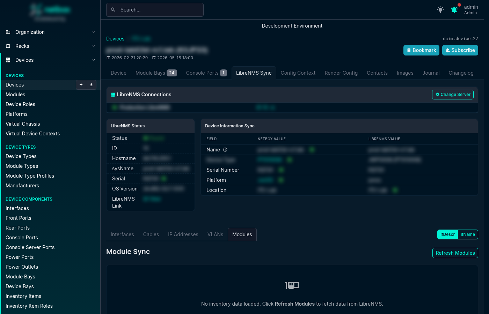

# Module Sync

The Module Sync tab lets you reconcile LibreNMS physical inventory (ENTITY-MIB, plus a transceiver API source for vendors that don't expose SFPs via ENTITY-MIB) with the installed modules recorded in NetBox. It appears as a **Modules** tab on the LibreNMS Sync page for every Device and Virtual Chassis.

## How It Works

When you open the Modules tab, the plugin fetches the ENTITY-MIB inventory tree from LibreNMS, merges in transceiver data from the LibreNMS transceiver API (used for vendors that don't expose SFPs via ENTITY-MIB), and compares each line-card, transceiver, fan, power supply, and other physical component against the NetBox module bays and installed modules for that device.

Slots and cages that only hold hardware get no row of their own. The hardware inside them gets the row. An entity is a holder when its model is `builtin`, `default` or `n/a`, when its model is empty and it has no serial, or when it is a `container` or `port` entity without a serial that is not identified as a transceiver. An entity with an empty model and a serial is hardware and keeps its row. For example, NX-OS reports its fan bays, power supply bays and port cages with a label as the model but with no serial. A container with a serial, such as a Junos FPC, is hardware and keeps its row.

Each row in the table shows:

- **LibreNMS Name** — the `entPhysicalName` value reported by the device
- **LibreNMS Model** — the `entPhysicalModelName` value (used for type matching)
- **Serial** — `entPhysicalSerialNum`
- **Status** — the result of matching (see below)
- **NetBox Bay** — the module bay the component was matched to
- **NetBox Module** — the installed module in that bay (if any)
- **Actions** — buttons to install, update, or map the component

## Match Statuses

| Status | Meaning |
|--------|---------|
| **Matched** | LibreNMS component matches an installed NetBox module (same bay, same or mapped type) |
| **No Bay** | A bay mapping was found but no matching module bay exists on this device |
| **No Type** | The bay was found but no ModuleTypeMapping exists for the LibreNMS model |
| **Name Conflict** | The resolved bay name conflicts with an existing module in another bay |
| **Not Installed** | A matching bay exists but no module is installed yet |

An installed module also shows an **Interface Type** badge when the type of one or more of its interfaces differs from its module template. Hover the badge to see the interface names.

## Missing Parent Rows

Some Juniper MX optics report a parent index that no inventory row has. The description of each optic ends with an `@ fpc/pic/port` locator, for example `@ 1/0/2`. When exactly one PIC row (`PIC: ... @ 1/0/*`) inside the FPC container of the same slot (`FPC: ... @ 1/*/*`) matches, the plugin uses that PIC as the parent. An information icon beside the status names the reported index.

When no single PIC matches, the row keeps the reported parent and shows a **Parent Missing** badge. Hover the badge to see the reported index. The row still gets a bay guess and the install actions, so check the bay before you install it.

Junos EVO reports each PIC row (`PIC: ... @ 0/0/*`) with its slot number as parent, so when a PIC row is not below an FPC row of its slot and exactly one FPC row of that slot exists, the plugin puts the PIC and its optics below that FPC row, with no badge.

## Taking Action

Only an install action (**Install**, **Install Carrier**) shows its label in the Actions column. Every other action is an icon button: hover it for a tooltip, and a screen reader announces its name.

- **Install**: installs a new module into the matched bay using the mapped ModuleType
- **Install Branch**: installs the module and all its installable children
- **Update Serial** / **Update Interface**: updates the serial of an installed module, or links a matching NetBox interface to it
- **Replace** / **Move**: replaces a mismatched module, or moves a module with the same serial from another bay
- **Review Interface Types**: on an installed module whose interface types differ from its module template (you need the view permission for devices, modules and interfaces, and the change permission for interfaces), opens a preview of the differing interfaces and applies the template types you select
- **Add Bay Mapping** / **Add Type Mapping** / **Map Existing Bay** / **Add Module Type**: resolve "No Bay" or "No Type" statuses without leaving the page
- **Add Bay Template**: if the device type is missing a module bay template, this button creates it inline

Each module action is valid only for the state the table was rendered from: the same cached inventory, the same Inventory Ignore Rules and serial Normalization Rules, and the same Virtual Chassis devices (serial, position and device type). When one of these changes, the action changes nothing and tells you to refresh the table. A change to any rule refuses open pages, also when the rule does not touch their rows. When an enabled rule stores a regex or a replacement that does not work, the tab names the rule and shows no table, and no module action runs until you fix the rule. When LibreNMS reports one entPhysicalIndex for two rows, the table offers no module action.

**Install Selected** installs all of the selected rows or none of them. Each row installs on the member that the table shows for it. To install a row on another member, select that member in the row: the plugin checks the row for that member, and the row actions and **Install Selected** wait until the check is complete. **Install Branch** installs the rows that the table shows below the module.

## Module Interfaces

When a module type defines interface templates, installing the module also reconciles the device's interfaces with those templates. The plugin works out the names the module's interfaces should have (instantiating each interface template against the device, and rewriting names for Virtual Chassis members where needed), then adopts any existing standalone interfaces on the device that match those names into the newly installed module. This keeps interfaces that were created by a previous interface sync from being duplicated, and links them to the module that physically provides them.

For vendors whose naming conventions cannot be derived from templates alone, the predicted names can be adjusted by another plugin through a signal hook — see [Extension Points](../development/extension_points.md) for details.

When the predicted names expand the templates into more interfaces (for example a breakout optic with a parent interface and its channels), the plugin moves only the interfaces with the template names into the module. The other interfaces of the family stay where they are, so that the naming plugin can take them over. The install still binds the LibreNMS port to the matched interface, also when that interface is a channel that stays outside the module.

## Carrier Modules

Some chassis (e.g. Nokia 7750 SR-s) report child components (CPMs, MDAs) without the intermediate carrier/holder module that must first be installed in NetBox before the children become visible. When a CarrierAutoInstallRule matches, an **Install Carrier** button appears — clicking it installs the carrier module into the appropriate empty bay, after which the children can be synced normally.

## Virtual Chassis Support

For Virtual Chassis devices, the Modules tab automatically distributes inventory rows across the correct VC member based on the component's position in the ENTITY-MIB tree. Each row shows the member hostname to make it clear which physical switch a component belongs to.

When the inventory is a stack that import detection recognizes, only a member row (for example a stack chassis or a Junos FPC) names a member by its position. Rows below a member row belong to that member, unless a serial names another member. The stack root and rows directly under it belong to the device whose page is open. For an inventory that is not a recognized stack, the plugin reads a position of 1 or more, or a leading number in the name, as the member number.

On a Junos Virtual Chassis, all members hang under one root. A row such as "FPC 1 Power Supply 0" belongs to the same member as the FPC that reports slot 1, and a row below an FPC belongs to that FPC's member. An FPC's member comes from its serial first, then from its detected position. If no FPC or more than one FPC reports the slot, the row stays on the open page. Routing Engine numbers are not member numbers.

## Screenshot

## Related Configuration

Before using Module Sync you will typically need to configure one or more [mappings](../configuration/mappings.md) or [rules and patterns](../configuration/rules_and_patterns.md):

- **ModuleTypeMapping** — maps LibreNMS model strings (e.g. `SFP-1G-T`) to NetBox ModuleType objects
- **ModuleBayMapping** — maps LibreNMS bay names (e.g. `Power Supply 1`) to NetBox bay names (e.g. `PSU1`), with optional regex and manufacturer scoping
- **NormalizationRule** — strips vendor suffixes from model strings before matching (e.g. `3HE16474AARA01` → `3HE16474AA`)
- **InventoryIgnoreRule** — admits the inventory classes the tab shows (one seeded rule per class, optionally narrowed by name, description or model), and skips or makes transparent phantom EEPROM/IDPROM entities that some vendors (Cisco IOS-XR) report, and the built-in units of fixed platforms (Cisco IOS XE)
- **CarrierAutoInstallRule** — suggests installing carrier modules for vendors that omit them from SNMP reporting
